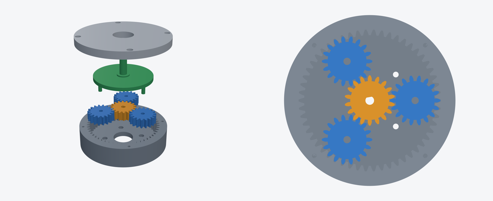

# Planetary (sun) gearbox — 4:1, NEMA17 input



Parametric model in [build123d](https://github.com/gumyr/build123d) (OpenCascade B-rep). Edit the parameters at the top of `gearbox.py` and run it again.

| | |
|---|---|
| Ratio | 4:1 (sun 18T → 3× planet 18T, fixed ring 54T, carrier output) |
| Gears | module 1.5, 20° involute, 10 mm face width, 0.15 mm print backlash |
| Size | Ø102 × 32 mm (+13 mm output shaft) |
| Input | NEMA17: Ø5 D-shaft, 31 mm M3 pattern (counterbored inside the floor) |
| Output | Ø8 shaft with flat, carried by a 608 bearing in the lid |

## Files (`out/`)
- `assembly.step`: full assembly; import into Onshape (*Import* → creates a Part Studio)
- `housing_ring.step/.stl`, `sun`, `planet` (print 3), `carrier`, `lid`

## Hardware
- 1× 608 bearing (8×22×7)
- 4× M3×8 (motor), 4× M3×12 self-tapping (lid)
- Motor shaft protrusion ≤ 22 mm (trim if longer)

## Build
```bash
pip install build123d
python gearbox.py
```
Constraints are checked at runtime: `ZR = ZS + 2·ZP` and `(ZS+ZR)/N` must be an integer.
