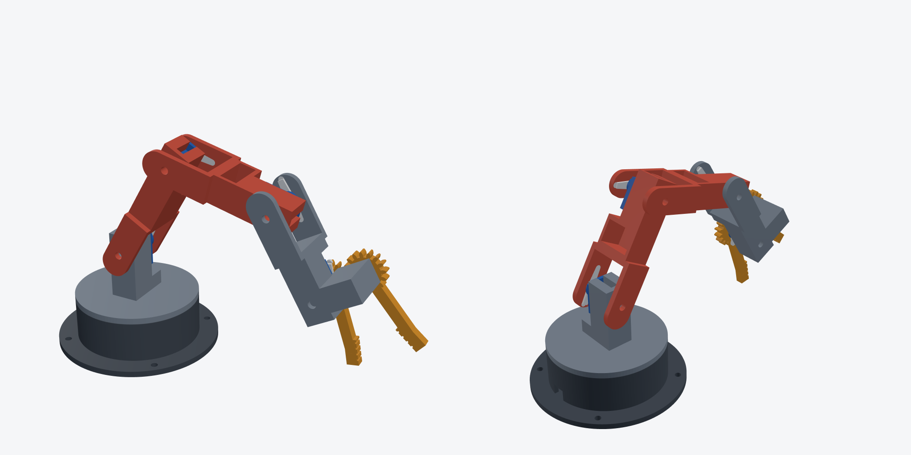

# 4-axis desktop robot arm (MG90S) with gear gripper

Original parametric design in [build123d](https://github.com/gumyr/build123d) (`arm.py`). 4 axes (base yaw, shoulder, elbow, wrist) plus a parallel gear gripper, driven by 5 × MG90S micro servos.
Reach is about 26 cm from the shoulder.

**Joint design:** every pitch joint is supported on both sides. The servo horn press-fits into a pocket in one cheek of the next link. A printed pin on the servo axis carries the other cheek, so the servo's output shaft takes no bending load.
**Hardware:** only the screws in each MG90S bag, plus printed pins.

## Print list (`out/*.stl`, already in print orientation, no supports)
| Part | Qty | ~Mass |
|---|---|---|
| base | 1 | 36 g |
| turntable_shoulder | 1 | 20 g |
| upper_arm | 1 | 13 g |
| forearm | 1 | 12 g |
| gripper_body | 1 | 17 g |
| gear_driven / gear_idler | 1 each | 2 g |
| pin_joint | **3** | small |
| pin_gear | 1 | small |

PLA or PETG, 0.2 mm layers, 3 walls, 25 % infill. Fits are tuned for an **Elegoo Neptune 4 Pro** (see `CLR`, `PRESS`, `HORN_FIT`, `SERVO_CLR` at the top of `arm.py`).
Print `pin_joint` and one link first to check the pin press fit and the servo pocket.

## Bill of materials
- 5 × MG90S servo (metal gear), with their horn bags. Uses the **long 2-arm horn**.
- Arduino Uno/Nano (or ESP32), plus a **separate 5–6 V, ≥3 A supply** for the servos (common GND)
- Optional: servo extension leads (20 cm) for J4/J5

## Assembly
Centre every servo first: upload the sketch, power it, and the servos move to `HOME` (90°). Fit each horn pointing along its link.
1. **Base (J1):** drop the servo into the base pocket, shaft up, cable through the slot, and screw the tabs (2 × bag screws).
2. Press the J1 horn into the pocket under the **turntable**, set it on the spline, and drive the horn screw down through the channel in the shoulder stand.
3. **Shoulder (J2):** slide the servo into the stand's cradle from the open side and screw the tabs. Press its horn into the **upper arm**'s horn cheek, put it on the spline, and add the horn screw from outside. Push a `pin_joint` through the opposite cheek into the cradle floor.
4. Repeat for the **elbow (J3)**: servo in the upper arm's cradle, then the forearm. Repeat for the **wrist (J4)**: servo in the forearm, then gripper_body.
5. **Gripper (J5):** servo in the gripper_body cradle. Press its horn into `gear_driven`, then mesh `gear_idler` (fingers closed) and fix it with `pin_gear` into the ear.

## Wiring and test (`firmware/arm_test/arm_test.ino`)
| Joint | Pin | Home |
|---|---|---|
| J1 base | D3 | 90 |
| J2 shoulder | D5 | 90 (arm vertical) |
| J3 elbow | D6 | 90 |
| J4 wrist | D9 | 90 |
| J5 gripper | D10 | 60 |

Use the Serial monitor at 115200 baud: `2 120` moves the shoulder to 120°, `home` returns to home, `demo` runs a pick-and-place loop.

## Limits (be aware)
- **Torque:** at full horizontal reach the shoulder needs about 1.1 kg·cm empty. The MG90S gives about 1.8 kg·cm at 4.8 V and 2.2 kg·cm at 6 V. Run the servos at 6 V. Payload is about 20 g near full reach, more when the arm is tucked in.
- **Tipping:** the arm outweighs the base when extended. **Screw the base to a board** using the 4 Ø4.5 holes, or add weight.
- Mechanical joint travel is ±130°, beyond the servos' own 180°, so the soft limits are in the sketch. Tune `MIN_A`/`MAX_A` so the arm can't drive into the table.
- The servo dimensions are nominal MG90S values. Measure yours and edit the `SV_*` / `HORN_*` constants if needed.
