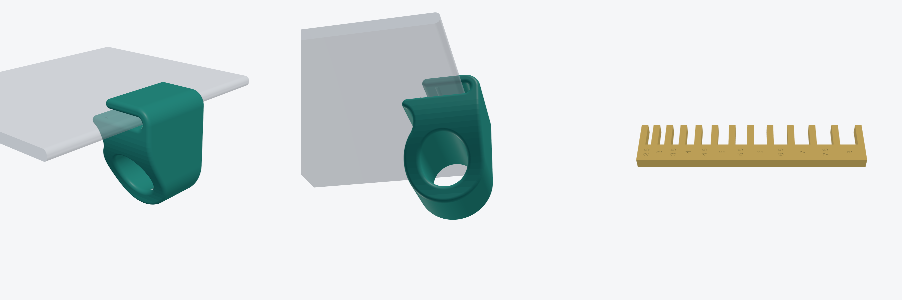

# Clip-on tray hook with tie ring

A smooth "J" clip that slides over the outer edge of a high-chair tray (designed with the Stokke® Tray in mind). It has a Ø14 mm ring for tying a toy or a pacifier strap.
Parametric build123d model: `hook.py`.

## 1. Measure the tray edge (the instruction sheet has no dimensions)
1. Print `out/edge_gauge.stl`. It's a comb with slots from 2.5 to 8 mm in 0.5 mm steps, and takes about 10 minutes.
2. Push it onto the tray's outer edge where you want the hook. Note the **smallest slot that slides on**.
3. Set `EDGE_T` in `hook.py` to that number, run `python hook.py`, and print `out/hook.stl`.

If the edge isn't a flat lip (for example a rolled or hollow rim), send a photo of the edge from the side with a ruler, and the profile can be adapted.

## 2. Print
- **PETG** recommended. It's tougher than PLA for a snap clip and survives a 60 °C dishwasher; PLA softens around 55 °C. Hand-wash either way.
- The STL is already oriented: flat back face down, no supports, layers running along the clip arms (strongest direction for a clip).
- 0.2 mm layers, 4 walls, 40 % infill.

## 3. Fit tuning
| Parameter | Default | If… |
|---|---|---|
| `EDGE_T` | 3.5 mm | from the gauge |
| `GRIP` | 0.35 mm | too hard to slide on → 0.2, falls off → 0.5 |

## Child-safety notes (read before use)
- **Short tethers only.** Keep any cord or strap tied to the ring under **22 cm** (the EN 12586 pacifier-holder limit). Never use loops or anything that can go around a neck.
- **Loads:** light toys only. The tray's own warning says hanging weight on the tray can tip the chair. Never let the child hang or pull on it.
- **Small parts:** the hook is sized (26 mm wide) so it can't fit the Ø31.7 mm small-parts test cylinder. Still, inspect it for cracks and throw it away if damaged.
- **Finger entrapment:** the ring hole (Ø14) is above the 5–9.5 mm finger-entrapment range.
- 3D-printed plastic is porous and not certified for mouthing or food contact. Supervise use.
